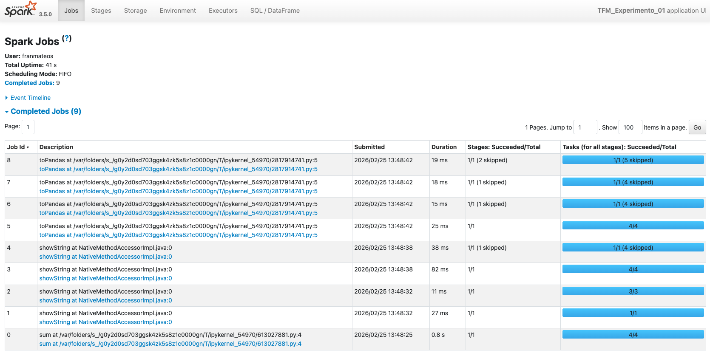
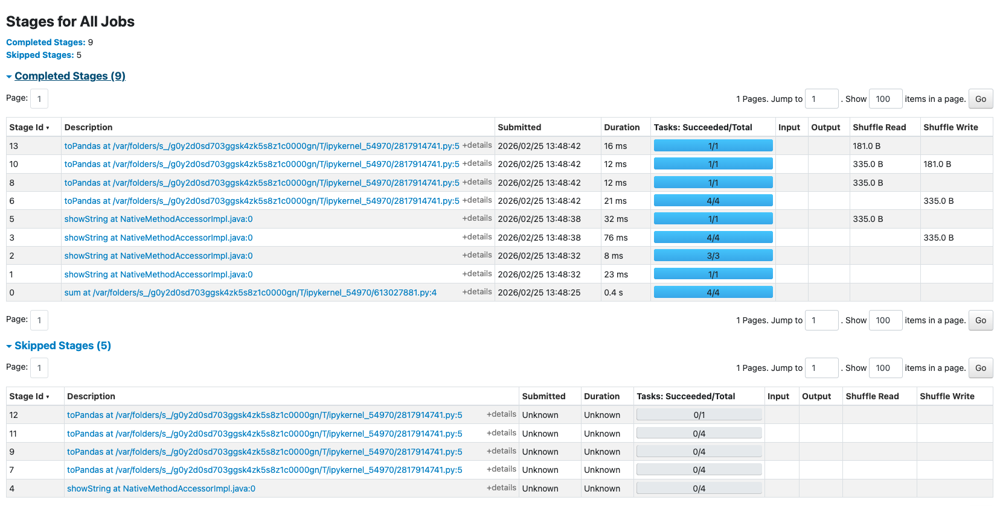

---
header-includes:
  - \usepackage{fancyhdr}
  - \pagestyle{fancy}
  - \fancyhead[L]{Francisco Mateos Díaz}
  - \fancyhead[R]{TFM, Curso 2025-2026}
  - \fancyfoot[C]{\thepage}
  - \usepackage{tikz}
  - \usetikzlibrary{decorations.pathreplacing,positioning,arrows.meta}
  - \usepackage{listings}
  - \lstset{basicstyle=\ttfamily\small, breaklines=true, frame=single, numbers=left, numberstyle=\tiny}
geometry: margin=2.5cm
---
# Documento hito #5 (de 6) de mes 2

\begin{center}
\begin{tikzpicture}[scale=0.72]
    \draw[thick,->] (0,0) -- (14,0) node[right]{\small Semanas};
    \foreach \x/\lab in {0/0,2.8/4,5.6/8,8.4/12,11.2/16,14/20} {
        \draw (\x,0.1) -- (\x,-0.1) node[below]{\tiny \lab};
    }
    % Mes 1 - debil
    \fill[yellow!15] (0,0.8) rectangle (2.8,1.5);
    \node[font=\scriptsize, text=black!40] at (1.4,1.15) {Estado del Arte};
    % Mes 2 - destacado
    \fill[blue!60] (2.8,0.8) rectangle (5.6,1.5);
    \draw[blue!80, thick] (2.8,0.8) rectangle (5.6,1.5);
    \node[font=\scriptsize\bfseries] at (4.2,1.15) {Dise\~no};
    % Mes 3 - debil
    \fill[green!15] (5.6,0.8) rectangle (8.4,1.5);
    \node[font=\scriptsize, text=black!40] at (7,1.15) {Implementaci\'on};
    % Mes 4 - debil
    \fill[orange!15] (8.4,0.8) rectangle (11.2,1.5);
    \node[font=\scriptsize, text=black!40] at (9.8,1.15) {Experimentaci\'on};
    % Mes 5 - debil
    \fill[red!15] (11.2,0.8) rectangle (14,1.5);
    \node[font=\scriptsize, text=black!40] at (12.6,1.15) {Redacci\'on};
    % Hitos
    \foreach \x in {2.8,5.6,8.4,11.2,14} {
        \node[draw,circle,fill=gray!30,inner sep=1pt,font=\tiny,text=black!40] at (\x,2) {H};
    }
    % Hito mes 2 destacado
    \node[draw,circle,fill=blue!70,inner sep=1.5pt,font=\tiny\bfseries,text=white] at (5.6,2) {H};
    % Flecha vertical apuntando al mes 2
    \draw[blue!80, very thick, ->, >=stealth] (4.2,2.8) -- (4.2,1.6);
    \node[font=\footnotesize\bfseries, blue!80] at (4.2,3.1) {};
\end{tikzpicture}
\end{center}

# Entorno Spark: Configuración y Validación

**TFM:** Selección Automática de Características en Algoritmos de Clasificación Mediante Algoritmos Genéticos y Métodos de Envoltorio con Apache Spark RDD

**Notebook:** [`notebooks/00_spark_setup_template.ipynb`](https://github.com/fmateos/AFSGAW/blob/main/notebooks/00_spark_setup_template.ipynb)

---

Como paso previo al desarrollo del algoritmo genético, se ha creado un notebook de configuración y validación del entorno Spark. El objetivo es verificar que PySpark está correctamente instalado y que la sesión puede inicializarse con los parámetros necesarios para el proyecto, antes de incorporar Spark como motor de paralelización en los experimentos principales.

El notebook cubre tres áreas: la configuración de la `SparkSession` con los parámetros de memoria y paralelismo adecuados, la ejecución de operaciones básicas con RDDs y DataFrames para comprobar el correcto funcionamiento de las APIs principales, y la inspección de la Spark Web UI para confirmar que los jobs se distribuyen y ejecutan como se espera.

---

## 1. Configuración del entorno

La sesión de Spark se construye mediante la API `SparkSession.builder` de PySpark ([pyspark.sql.SparkSession](https://spark.apache.org/docs/3.5.0/api/python/reference/pyspark.sql/api/pyspark.sql.SparkSession.html)), que expone un patrón fluent para encadenar opciones de configuración antes de llamar a `.getOrCreate()`:

```python
from pyspark.sql import SparkSession

spark = SparkSession.builder \
    .appName("TFM_Experimento_01") \
    .master("local[*]") \
    .config("spark.driver.memory", "4g") \
    .config("spark.executor.memory", "4g") \
    .config("spark.sql.shuffle.partitions", "4") \
    .config("spark.default.parallelism", "4") \
    .config("spark.ui.enabled", "true") \
    .config("spark.ui.port", "4040") \
    .config("spark.driver.host", "localhost") \
    .config("spark.driver.bindAddress", "127.0.0.1") \
    .config("spark.sql.execution.arrow.pyspark.enabled", "true") \
    .getOrCreate()
```

La localización de la instalación de Spark en el sistema se delega en findspark ([findspark](https://pypi.org/project/findspark/)), que llama a `findspark.init()` para añadir el directorio de PySpark al `sys.path` antes de cualquier importación, evitando la necesidad de configurar manualmente `SPARK_HOME` o `PYTHONPATH`.

El nivel de log se ajusta a través de `spark.sparkContext.setLogLevel("WARN")` para suprimir mensajes informativos durante la ejecución del notebook y reducir el ruido en la salida.

Los parámetros resultantes de la sesión son:

| Parámetro | Valor |
|---|---|
| App Name | `TFM_Experimento_01` |
| Master | `local[*]` (todos los cores disponibles) |
| Spark Version | 3.5.0 |
| Python Version | 3.9 |
| Driver Memory | 4 GB |
| Executor Memory | 4 GB |
| Default Parallelism | 4 |
| Shuffle Partitions | 4 |
| Arrow para Pandas | habilitado |
| Spark Web UI | http://localhost:4040 |

El modo `local[*]` instruye a Spark para que use todos los núcleos de la máquina como workers dentro del mismo proceso JVM, proporcionando paralelismo real sin necesidad de un clúster externo. Con 4 cores disponibles, Spark crea 4 particiones por defecto para distribuir el trabajo. La opción `spark.sql.execution.arrow.pyspark.enabled` activa la serialización mediante Apache Arrow ([pyarrow](https://arrow.apache.org/docs/python/)) en las conversiones entre DataFrames de Spark y Pandas, reduciendo significativamente el coste de `.toPandas()`.

---

## 2. Ejecución de ejemplos simples con RDDs

Para validar el entorno se ejecutan cuatro tests progresivos que cubren las principales APIs de Spark:

### Test 1 — RDD básico con transformación `map`

```python
rdd = spark.sparkContext.parallelize(range(1_000_000))
resultado = rdd.map(lambda x: x**2).sum()
# → Suma de cuadrados (0 a 999999): 333,332,833,333,500,000
```

Se crea un RDD de 1 millón de elementos, se aplica una transformación `map` (operación lazy) y se materializa con la acción `sum`. Spark divide el rango en particiones distribuidas entre los workers locales.

### Test 2 — DataFrame con schema explícito

```python
datos = [("Alice", 25, "Engineering"), ("Bob", 30, "Finance"), ...]
df_spark = spark.createDataFrame(datos, ["Nombre", "Edad", "Departamento"])
df_spark.show()
```

Valida la creación de DataFrames estructurados y la inferencia de tipos (`string`, `long`).

### Test 3 — Spark SQL sobre vista temporal

```python
df_spark.createOrReplaceTempView("empleados")
resultado_sql = spark.sql("""
    SELECT Departamento, COUNT(*) as cantidad, AVG(Edad) as edad_promedio
    FROM empleados GROUP BY Departamento ORDER BY cantidad DESC
""")
```

Confirma que el motor SQL de Spark funciona correctamente sobre DataFrames registrados como vistas.

### Test 4 — Conversión a Pandas y visualización

Se ejecuta `.toPandas()` (acelerado por Arrow) para recolectar los resultados en el driver y generar visualizaciones con matplotlib y seaborn. Este paso valida la interoperabilidad entre el DataFrame de PySpark y el ecosistema científico de Python: los datos procesados en el clúster se transfieren al proceso driver como un `pandas.DataFrame` estándar, disponible para cualquier librería de análisis o visualización.

---

## 3. Spark Web UI

### Jobs completados



La vista Jobs muestra los 9 jobs completados durante la sesión de validación. Cada test del notebook genera uno o varios jobs:

- Los jobs asociados a `parallelize` + `map` + `sum` (Test 1) producen stages con múltiples tasks ejecutadas en paralelo.
- Los jobs de DataFrame y SQL (Tests 2–4) generan stages de menor duración al operar sobre datos pequeños.
- La columna Stages confirma la correcta división en stages (entre 1 y 12 stages por job según la complejidad).
- La columna Tasks refleja el paralelismo efectivo: los jobs sobre el RDD de 1M elementos distribuyen las tareas entre los 4 workers disponibles.

### Stages completados y skipped



La vista Stages desglosa la ejecución interna de cada job:

- **9 stages completados** con métricas de duración, input/output y shuffle read/write.
- **5 stages skipped** (marcados en gris): Spark detectó que los datos ya estaban cacheados o que el resultado podía reutilizarse, evitando recomputación innecesaria — indicador de que la optimización del planificador (Catalyst) está activa.
- Los stages del RDD grande muestran shuffle write*de ~332 B, resultado del `sum` agregado entre particiones.
- Las duraciones oscilan entre <1 ms (stages triviales) y ~55 ms (stages con transformaciones sobre 1M elementos), tiempos coherentes con una ejecución local en modo `local[*]`.

---

## 4. Conclusión

La sesión de Spark queda validada con los siguientes criterios:

- Spark 3.5.0 se inicializa correctamente en modo `local[*]` con 4 workers efectivos.
- Los RDDs se crean, transforman y materializan sin errores, con distribución real del trabajo entre particiones.
- DataFrames, Spark SQL y la conversión a Pandas funcionan con coherencia de tipos y resultados correctos.
- La Web UI refleja la ejecución completa: 9 jobs, stages con tasks paralelas, optimización por skip de stages ya cacheados y métricas de shuffle.

El entorno está listo para soportar los experimentos de evaluación paralela del Algoritmo Genético definidos en fases posteriores del TFM.
